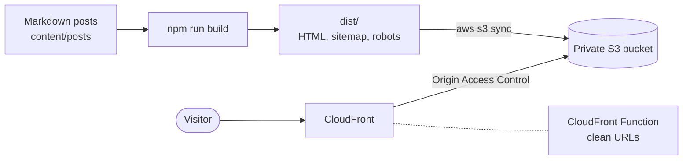

# static-site-aws

[](https://github.com/ge0ffr3y/static-site-aws/actions/workflows/ci.yml)

Write Markdown, get a fast static site served from a **private S3 bucket behind CloudFront**. The Terraform that creates the hosting is included, along with a deploy script and a GitHub Actions workflow that deploys without storing any AWS keys.

It is extracted and generalized from the pipeline that runs my own site, [geoffleediker.com](https://geoffleediker.com).



## What you get

- **A small static site generator.** Posts are Markdown files with frontmatter. The build writes pages, a blog index, a 404 page, `sitemap.xml`, and `robots.txt`. Every page gets a canonical URL.
- **Hosting as code.** A private bucket with encryption and versioning, a CloudFront distribution, security headers, and an optional custom domain with a certificate.
- **A least-privilege deploy.** The deploy identity can write to one bucket and invalidate one distribution, and nothing else.
- **CI/CD without long-lived keys.** GitHub Actions assumes an AWS role through OIDC, limited to one repository and one branch.
- **Tests,** including tests for the CloudFront Function that Terraform deploys.

## Quick start (local)

```bash
npm ci
npm test
npm run build      # writes dist/
```

Edit `site.config.json` (URL, title, author) and add posts under `content/posts/`. Frontmatter:

| Field | |
|---|---|
| `title`, `date` | Required. Use `YYYY-MM-DD` for the date. |
| `excerpt` | Optional. Defaults to the first sentence of the post. |
| `tags` | Optional list. |
| `slug` | Optional. Defaults to the filename. |
| `draft: true` | Keeps the post out of the build. |

Files in `site/` (CSS, images, anything else) are copied into `dist/` unchanged.

## Deploy

You need Terraform 1.6+, the AWS CLI, and credentials that can create the resources in `infra/terraform`.

```bash
cd infra/terraform
cp terraform.tfvars.example terraform.tfvars   # set bucket_name at minimum
terraform init
terraform apply
```

Then deploy the site, using the values Terraform prints:

```bash
export S3_BUCKET=$(terraform output -raw bucket_name)
export CLOUDFRONT_DISTRIBUTION_ID=$(terraform output -raw distribution_id)
cd ../..
DRY_RUN=1 scripts/deploy.sh    # preview what would change
scripts/deploy.sh              # build, upload, invalidate the cache
```

Set `SITE_URL` (or `siteUrl` in `site.config.json`) to the address the site is served from, so canonical tags and the sitemap are correct.

### Deploying from GitHub Actions

Set `github_repo = "owner/name"` in `terraform.tfvars` and apply. Terraform creates an OIDC provider and a deploy role that only that repository's `main` branch can assume. Then add these repository variables (Settings, Secrets and variables, Actions, Variables):

| Variable | Value |
|---|---|
| `AWS_DEPLOY_ROLE_ARN` | `terraform output github_deploy_role_arn` |
| `S3_BUCKET` | `terraform output bucket_name` |
| `CLOUDFRONT_DISTRIBUTION_ID` | `terraform output distribution_id` |
| `SITE_URL` | the address the site is served from |

The role trusts tokens from your repository's `main` branch only. GitHub puts either `repo:owner/name` or, for newer repositories, `repo:owner@<id>/name@<id>` in the token, and the trust policy accepts both. To pin the exact value, set `github_subject_prefix` to the `sub_claim_prefix` from `gh api repos/OWNER/NAME/actions/oidc/customization/sub`.

The deploy workflow does nothing until `AWS_DEPLOY_ROLE_ARN` is set. An AWS account can have only one GitHub OIDC provider; if yours already exists, set `create_github_oidc_provider = false` and pass `github_oidc_provider_arn`.

## Design decisions

**A private bucket with Origin Access Control, not S3 website hosting.** The website endpoint requires a public bucket and only speaks HTTP to CloudFront. With OAC the bucket stays private, CloudFront signs its requests, and a bucket policy limits reads to this one distribution. The cost is that the S3 REST endpoint doesn't understand index documents, which is what the next item is for.

**A CloudFront Function maps clean URLs to `index.html`.** `/blog/` becomes `/blog/index.html`. It's cheaper and simpler than Lambda@Edge, and the same file Terraform deploys is unit-tested here, including a check that every page the build produces is reachable through it.

**403s become 404s.** A private bucket answers 403 for keys that don't exist, so the distribution maps both 403 and 404 to the real `404.html`.

**Deploys set `Cache-Control: no-cache` by default.** A CloudFront invalidation clears the CDN, but not copies already cached in visitors' browsers, so a visitor can get a new page with a stale stylesheet. `no-cache` makes browsers revalidate on every load; it costs a conditional request, and you save the bandwidth when the file hasn't changed. For large assets, set `CACHE_CONTROL` or fingerprint file names.

**The deploy policy is least privilege.** `s3:PutObject`, `GetObject` and `DeleteObject` on this bucket's objects, `s3:ListBucket` on this bucket, and `cloudfront:CreateInvalidation` on this distribution. The GitHub role's trust policy is pinned to `repo:<owner/name>:ref:refs/heads/<branch>`, so other repositories and branches can't assume it.

**Builds are deterministic.** Sitemap dates come from the posts, not from file timestamps, so building twice gives identical output.

**Dates are calendar dates, formatted in UTC.** A date like `2026-07-24` is parsed at UTC midnight; formatting it in a timezone west of UTC would display the 23rd. A test runs in three timezones to prevent that regression.

## Tests

```bash
npm test
```

They cover slugs, first-sentence excerpts, date handling, frontmatter validation, draft and duplicate-slug handling, canonical URLs and the sitemap, HTML escaping, and the CloudFront Function. I also checked the tests by deliberately breaking the code and confirming they fail, which turned up one regex guard that did nothing and is now gone.

CI also runs `terraform fmt -check` and `terraform validate`, and `shellcheck` on the deploy script.

I also applied the Terraform to a real AWS account, deployed through it, and destroyed it. That checked:

- The site is served with clean URLs, the real 404 page, and the security headers, and the bucket answers 403 when requested directly.
- The deploy identity could sync and invalidate its own stack, and was denied everything else, including another bucket and distribution in the same account.
- The GitHub Actions workflow deployed through OIDC with no stored keys, and the same workflow run from another branch was refused.

The OIDC test also found a bug: the first version of the trust policy only matched `repo:owner/name`, which newer repositories don't send. That is fixed above.

## Cost

For a low-traffic site the bill is typically cents per month: S3 storage and requests, plus CloudFront usage that sits inside its always-free monthly allowance. A custom domain adds the Route 53 hosted zone fee. Check current AWS pricing for your region and traffic.

## Tear down

```bash
# Empty the bucket (including old versions), then:
terraform destroy
```

## Limitations

- No pagination, tag pages, RSS feed, or search. It is deliberately small.
- Markdown is rendered with [`marked`](https://github.com/markedjs/marked), and raw HTML in a post passes through unchanged. That's fine for a single trusted author, not for user-submitted content.
- Terraform state is local by default. Use a remote backend before sharing this with a team.

## About this repo

Built with AI coding assistance (Claude Code). The tests were checked by deliberately breaking the code and confirming they fail.

## License

MIT
